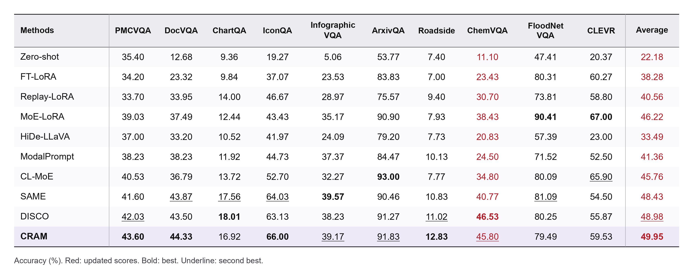

# Erratum: ChemVQA Evaluation on TriGap

An unexpected reference-matching behavior in the ChemVQA evaluation of TriGap was reported in [issue #7](https://github.com/LAMDA-CL/Prism/issues/7). Multiple questions associated with the same molecule image share a question ID, whereas the evaluation script assumed that each question ID corresponded to a single question. This document explains the resulting behavior and provides the corrected evaluation results.

## Question IDs and Reference Matching

In the TriGap ChemVQA test split, there are 3,000 questions but only 1,576 distinct question IDs. Different questions about the same molecule image can therefore have the same `question_id`.

The original evaluator in [`backbone/shared/eval/eval_deepseek_r1.py`](https://github.com/LAMDA-CL/Prism/blob/main/backbone/shared/eval/eval_deepseek_r1.py) indexed annotations using only `question_id`. When multiple annotations shared an ID, the dictionary retained the last annotation with that ID. As a result, predictions for different questions about the same image were compared against a single reference answer.

## Corrected Evaluation

Reference matching now uses **both the question ID and the question text**. Annotations are indexed by `(annotation['question_id'], annotation['text'])`, and predictions retrieve their references using `(result['question_id'], result['prompt'])`. The corresponding code change is available in [pull request #8](https://github.com/LAMDA-CL/Prism/pull/8).

## Updated Results

The table below presents the corrected TriGap results. **Only the ChemVQA scores and the corresponding averages are updated**. 

Under the corrected evaluation, DISCO achieves the highest ChemVQA accuracy at **46.53%**, followed by CRAM at **45.80%**. CRAM retains the highest average accuracy across the ten datasets at **49.95%**. Please use the corrected values in this table when reporting or comparing these results.

We thank the community for identifying this behavior and helping clarify the evaluation protocol.
